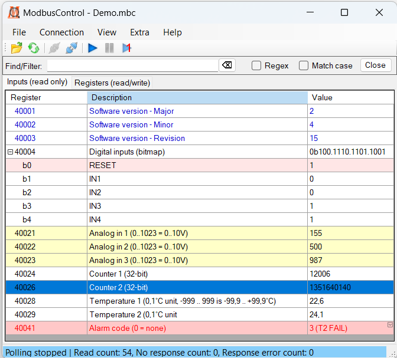

# ModbusControl

ModbusControl is a Windows based Modbus client application for testing, monitoring, and interacting with Modbus/TCP and Modbus serial/RTU devices.
It also includes command-line tools for importing and exporting Modbus configuration files.

## Features
- ModbusControl - Windows GUI Modbus client
- ModbusImport - command-line tool for importing Modbus project files
- ModbusExport - command-line tool for exporting Modbus project files
- RTU serial, Modbus/TCP, and RTU-over-TCP protocols
- .mbc files - XML project file
- 16 and 32-bit registers
- Int, uint, hex, binary, and float formats
- Expandable bit fields 
- Enumerations
- Strings
- User manual

## Development
C#, .NET (CORE) 9 framework, Visual Studio 2026.

It’s recommended to start Visual Studio with the '/noscale' option. This forces Visual Studio to run without DPI scaling (equivalent to 100% scaling or 96-DPI). 
If scaling is enabled, modifying form layouts may lead to unexpected behavior because mixed DPI values can be introduced. To avoid layout issues, keep the environment at 96 DPI whenever possible.
